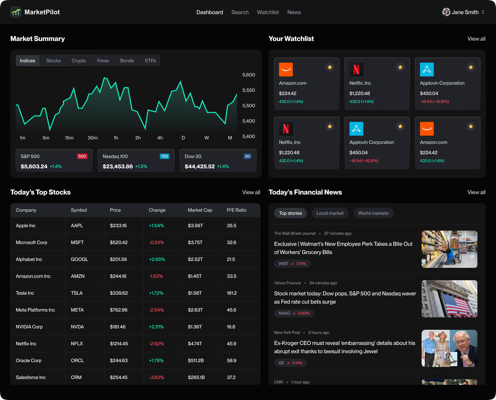

# MarketPilot

MarketPilot is a stock-tracking dashboard for exploring market activity, following stocks, and setting personalized price or volume alerts. It combines market data and company insights with charts and market news.



## Features

- Browse market summaries, stock data, and financial news.
- Search for stocks and explore detailed charts, company profiles, and financials.
- Manage a personal watchlist.
- Create price and volume alerts with configurable conditions and notification frequency.
- Receive welcome and market-news emails, and get notified when an alert is triggered.
- Sign up with an investment profile and manage your account.

## Tech stack

- Next.js 15, React 19, and TypeScript
- Tailwind CSS 4
- MongoDB with Mongoose
- Better Auth for email-and-password authentication
- Finnhub for stock data and news
- TradingView embedded widgets for charts and market visualizations
- Inngest for scheduled and event-driven jobs
- Nodemailer for email notifications

## Getting started

### Requirements

- Node.js (LTS recommended)
- npm
- A MongoDB database
- A Finnhub API key

### Install and configure

1. Install dependencies:

   ```bash
   npm install
   ```

2. Create a `.env.local` file in the project root and set the values below:

   ```dotenv
   MONGODB_URI=
   BETTER_AUTH_SECRET=
   BETTER_AUTH_URL=http://localhost:3000
   FINNHUB_API_KEY=
   NEXT_PUBLIC_BASE_URL=http://localhost:3000

   # Needed for welcome, news-summary, and alert emails.
   NODEMAILER_EMAIL=
   NODEMAILER_PASSWORD=
   ```

   Generate a unique secret for `BETTER_AUTH_SECRET`. `FINNHUB_API_KEY` is read on the server; the app also accepts `NEXT_PUBLIC_FINNHUB_API_KEY` as an alternative. Keep credentials private and do not commit your environment file.

3. Start the Next.js development server:

   ```bash
   npm run dev
   ```

4. Open [http://localhost:3000](http://localhost:3000).

The app's Inngest endpoint is available at `/api/inngest`. Run an Inngest development server alongside the app when testing scheduled alert checks and email workflows locally. Email features also require working Gmail SMTP credentials (use an app password where required).

## Available scripts

| Command           | Description                                 |
| ----------------- | ------------------------------------------- |
| `npm run dev`     | Start the development server with Turbopack |
| `npm run build`   | Create a production build                   |
| `npm run start`   | Serve the production build                  |
| `npm run lint`    | Run ESLint                                  |
| `npm run test:db` | Run the database connection check           |
